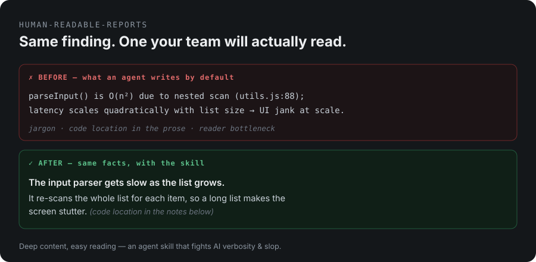

# human-readable-reports

**Your coding agent writes reports that are technically correct and unreadable.** Walls of jargon, `file:line` dumps, telegraphic bullets, invented terms. The team stops reading. This skill fixes that — deep content, easy reading.

   [](https://ko-fi.com/riversound)



---

## The problem (you're not imagining it)

"AI verbosity" and "AI slop" are now common complaints — LLMs are trained to write long, thorough, hedged answers, so their reports default to something only the author's other agent could love. When the doc is unreadable, **the human becomes the bottleneck.**

## The fix, in one look

> **Before** — what an agent writes by default:
> ```
> parseInput() is O(n²) due to nested scan (utils.js:88);
> latency scales quadratically with list size → UI jank at scale.
> ```
>
> **After** — same finding, with this skill:
> > **The input parser gets slow as the list grows.** It re-scans the whole
> > list for each item, so a long list makes the screen stutter.
> > *(code location in the notes below)*

Same facts. One of them your team will actually read.

## The 13 rules

1. **Reader-first** — name the reader before writing; by default, a junior dev who wasn't there.
2. **Point first** — each section opens with the takeaway in one plain sentence.
3. **Concrete before abstract** — one plain picture for a new concept; the real sequence of events for a cause or change.
4. **Full sentences**, not fragments — bullets for parallel items, sentences for cause and effect.
5. **Explain or drop jargon** — no bare formulas, no coined terms.
6. **Evidence to the back** — no `file:line` in the prose; put it in end-notes.
7. **Table cells read as phrases**, not code.
8. **Cut the slop** — no throat-clearing, no needless caveats, no padding.
9. **Progressive disclosure** — hide depth behind expandable sections.
10. **Tone: teammate, not lecture.**
11. **Numbers match the evidence** — nothing unmeasured, no claim stronger than the data.
12. **Shared-document hygiene** — no decoration or emoji; follow the last version's format.
13. **Articles and talks** may open with a scene, but never invent the author's experience.

Full rules, checklist, and the "when NOT to use it" boundary are in [`SKILL.md`](./SKILL.md).

> This README follows its own rules. That's the demo.

## Install

**Claude Code / Claude agents** — clone into your skills directory:

```bash
# personal (all projects)
git clone https://github.com/SummerRiversound/human-readable-reports \
  ~/.claude/skills/human-readable-reports

# or project-shared
git clone https://github.com/SummerRiversound/human-readable-reports \
  .claude/skills/human-readable-reports
```

The agent loads it automatically when you ask for a report or analysis doc.

**Cursor / other agents** — paste the rules from `SKILL.md` into your system
prompt or rules file. They're framework- and language-agnostic.

## When NOT to use it

Writing a **spec or plan an agent executes step-by-step**? Then precision beats
plainness — keep exact `file:line`, signatures, and code inline. This skill is
for the *human-facing* report.

## Contributing

Issues and PRs welcome — especially better before/after examples and rules that
catch failure modes not covered here.

## Support

If this skill saves you time, you can [buy me a coffee](https://ko-fi.com/riversound) — it helps keep the project moving. Thank you!

<a href="https://ko-fi.com/riversound"></a>

## License

MIT — see [`LICENSE`](./LICENSE).
